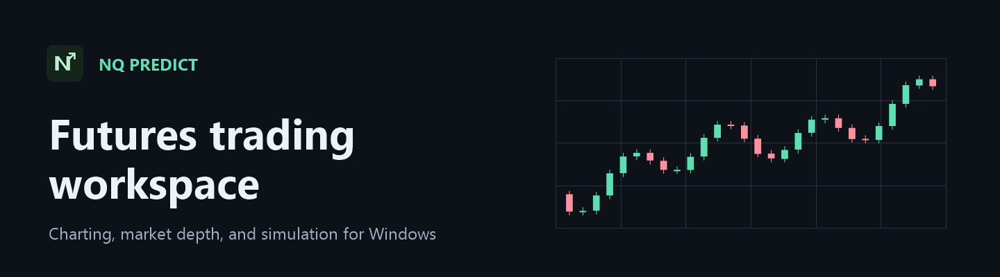

# NQ-Predict

[Get a beta key at nqpredict.com](https://nqpredict.com)

## What is NQ PREDICT?

NQ PREDICT is a Windows futures workspace for charting, depth of market, paper trading, prop firm practice, and strategy research. Use the Terminal to follow a dated futures contract and manage a simulated position, then use Journal & Analytics to review what worked.

## Get started

1. **Get a beta key.** Request one at the website linked above. A beta key activates the app for its assigned duration.
2. **Install the Windows app.** Open [GitHub Releases](https://github.com/NQPredict/NQ-Predict/releases) for the Windows x64 installer and changelog when a build is available.
3. **Sign in and activate.** Use Google or email. Email verification uses an eight-digit code. Enter your beta key when prompted and choose the display name shown on leaderboards and simulator certificates.
4. **Connect market data.** Install NinjaTrader 8 Desktop, sign in, and connect your data provider. In NQ PREDICT, open **Settings** and use the NinjaTrader bridge setup. Follow the in-app compile and restart instructions if prompted. Keep NinjaTrader Desktop running while using its feed. You can minimize it, and the add-on can request data without an open chart.
5. **Start with virtual funds.** In **Terminal**, select a market and create a standard paper account. Select **Prop Firm Simulator** to practice an evaluation or funded-account ruleset.

You need a Windows x64 PC and internet access for sign-in and activation. Market coverage, historical depth, and quote timing depend on the provider and data entitlements in NinjaTrader. Level 2 requires an entitled feed. The optional local AI agent connection requires Node.js.

## Workspace features

| Workspace | What you can do |
| --- | --- |
| **Terminal** | Browse futures across equity indexes, metals, energy, currencies, rates, agriculture, livestock, and crypto. Use eight chart intervals from one minute to one day, review stored history, and see the current candle countdown. |
| **Chart tools** | Search 66 built-in indicators, import historical TradingView CSV plots, or add custom JSON formulas that recalculate on new candles. Draw trend lines, channels, shapes, Fibonacci levels, ranges, risk/reward, text, and freehand marks. |
| **Ultra DOM** | See a tick-by-tick price ladder, best bid and ask, and available resting order sizes. The facelift preview shows the selected paper position at its average entry with a green up arrow for long or a red down arrow for short and the contract count. |
| **Paper trading** | Run multiple named accounts with separate balances, positions, and fills. Size orders using available equity and simulated day or overnight margin. Place market, limit, stop-market, and stop-limit orders. Move chart limits and exits, see position P&L, and close or reverse from the chart. |
| **Prop Firm Simulator** | Practice supported Lucid Pro, Flex, Daily, and Direct plans or a Topstep Trading Combine. Review profit targets, loss limits, consistency, and position caps. Follow evaluation progress, simulated funding, virtual payouts, and certificates. |
| **Forecasts** | Scan NQ and MNQ candles on an adjustable schedule. Compare ranked models using historical win rate, net P&L, and drawdown, and view pending or confirmed trade setups. Model automation can manage simulated trades in a standard paper account. |
| **News Intelligence** | Browse market headlines, public economic releases, and the release calendar. Follow scheduled events such as CPI and PCE and see estimated Nasdaq direction and impact when supported. |
| **Journal & Leaderboard** | Review trade history, notes, win rate, profit factor, and realized equity. Compare paper results and prop simulation results on separate leaderboards. |

## Trading modes and integrations

- **Paper** includes standard virtual accounts and accounts you create in the Prop Firm Simulator. Paper stops and targets use the executable quote side when the quote is fresh, with the bid for long exits and the ask for short exits.
- **Prop and Live** provide a workflow for opening NinjaTrader Desktop and selecting an external account. To connect an eligible Lucid Tradovate account, open **Settings → Lucid account in NinjaTrader** and follow the guide. Enter brokerage credentials and place external account orders in NinjaTrader.
- **AI agent connection** is available under **Settings** for a local MCP client. Select the standard paper account and market you want it to use, enable the connection, and copy the provided configuration into your client. You can disconnect it from the app.

## Help and feedback

Open **Settings** in the app for setup instructions. For a bug report, include the app version, the affected screen, and steps to reproduce. Include the dated contract and whether you were using market data or playback if the issue involves quotes or orders. [Open a GitHub issue](https://github.com/NQPredict/NQ-Predict/issues).

Paper trades, simulated payouts, and simulator certificates use virtual funds and achievements. Historical model results and forecasts are estimates of performance and do not guarantee future results. Futures trading involves risk.
